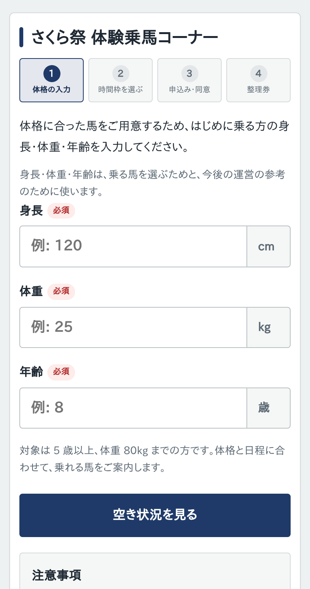
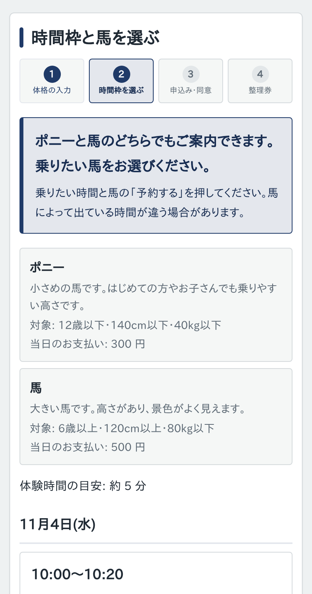
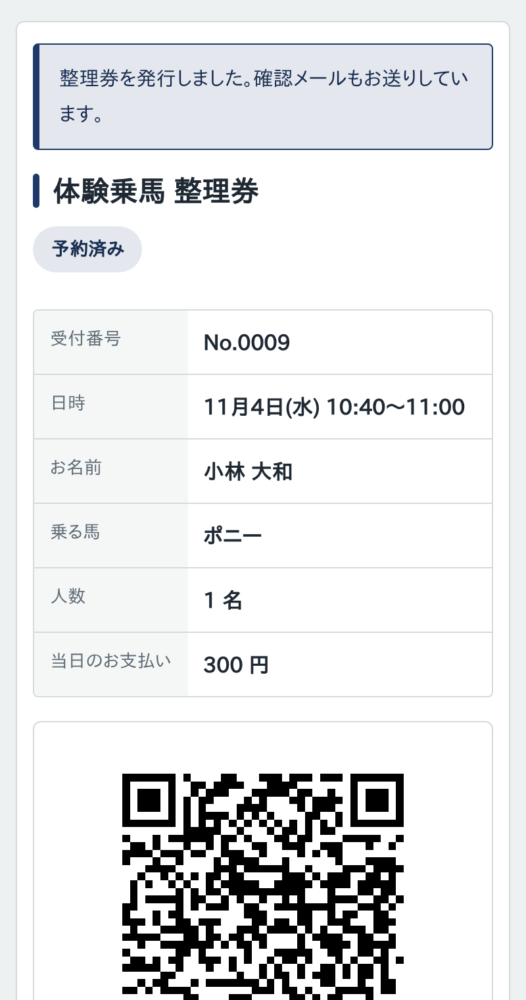
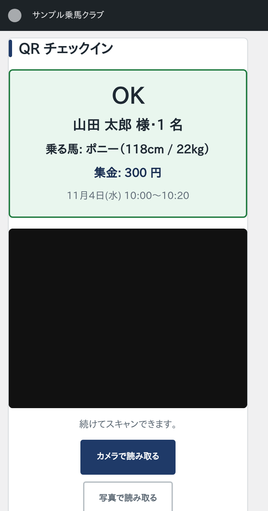

<div align="center">

# EquiTicket

### 体験乗馬のための、スマートフォンで使える整理券システム

**予約は来場者のスマホで。受付は QR をかざすだけ。**<br>
文化祭・地域のお祭り・乗馬クラブの体験会などで使える WordPress プラグインです。

[](https://github.com/haru-sudo/EquiTicket2/actions/workflows/ci.yml)
[](https://github.com/haru-sudo/EquiTicket2/releases/latest)
[](LICENSE)
<br>
[](https://wordpress.org/)
[](https://www.php.net/)
[](#開発者向けの情報)


[**ダウンロード**](https://github.com/haru-sudo/EquiTicket2/releases/latest) ・
[**かんたん導入ガイド**](#かんたん導入ガイド) ・
[**運用マニュアル（PDF）**](docs/manual/EquiTicket-運用マニュアル.pdf) ・
[**受付スタッフ用マニュアル（PDF）**](docs/manual/EquiTicket-受付スタッフ用マニュアル.pdf)

<br>

&nbsp;
&nbsp;
&nbsp;


<sub>① 体格を入力 → ② 時間を選ぶ → ③ QR 整理券を受け取る → ④ 受付でかざすだけ</sub>

</div>

---

> [!TIP]
> **パソコンが苦手な方へ** — 下の「[かんたん導入ガイド](#かんたん導入ガイド)」を上から順に進めるだけで使い始められます。
> 画面の写真付きの説明書（PDF）もあります。受付スタッフ用の 4 ページ版は、印刷して受付に置いておけます。

## 目次

- [こんな困りごとを解決します](#こんな困りごとを解決します)
- [できること](#できること)
- [用意するもの](#用意するもの)
- [かんたん導入ガイド](#かんたん導入ガイド)
- [当日の使い方](#当日の使い方)
- [困ったとき（よくある質問）](#困ったときよくある質問)
- [不具合の報告・要望](#不具合の報告要望)
- [開発者向けの情報](#開発者向けの情報)
- [ライセンス](#ライセンス)

---

## こんな困りごとを解決します

| これまで | EquiTicket を使うと |
| :-- | :-- |
| 長い行列ができ、いつ乗れるか分からない | 来場者が **スマホで時間を予約**。その時間に来ればよい |
| 紙の整理券の配布・管理が大変 | **QR 付きの整理券**を画面とメールで自動でお届け |
| 体格に合う馬かどうか、受付で毎回確認 | 身長・体重・年齢から **乗れる馬を自動で振り分け** |
| 無断キャンセルで枠が空いたままになる | 時間を過ぎた予約を **自動で空き枠に戻す** |
| 雨で中止…全員に連絡するのが大変 | 「中止」にするとき **予約者全員にお知らせメール** |

---

## できること

<table>
<tr>
<td width="33%" valign="top">

### 来場者
- 4 ステップの予約
  1. 身長・体重・年齢
  2. 時間を選ぶ
  3. 名前・メール・同意
  4. 整理券（QR）
- 確認メールの受け取り
- 自分で予約を取り消し

</td>
<td width="33%" valign="top">

### 運営する人
- 馬の種類（条件・料金）の登録
- 時間枠の作成（一括作成も）
- 頭数・定員の当日変更、中止
- 当日ダッシュボード
- 過去の記録
- 予約者への一斉メール
- 紙の名簿の印刷・CSV 書き出し

</td>
<td width="33%" valign="top">

### 受付スタッフ
- カメラで QR を読み取って受付
- 写真から読み取り（カメラが使えない端末用）
- 名前で探して受付
- 予約のない方の **当日予約**
- 集金額の表示

</td>
</tr>
</table>

> [!NOTE]
> 身長・体重で乗る馬が変わるため、**Web からの予約は 1 件につき 1 名**です。
> 予約のない方（飛び込み）は、スタッフが「当日予約」画面で人数をまとめて登録できます。

---

## 用意するもの

| 必要なもの | ひとこと |
| :-- | :-- |
| **WordPress のサイト**（5.8 以上） | レンタルサーバーの「WordPress 簡単インストール」で作ったサイトで動きます（PHP 7.2 以上・MySQL） |
| **https で開けること** | 受付でカメラを使うために必要です。レンタルサーバーの「無料 SSL」を有効にしてください |
| **受付用のスマホかタブレット** | 予備があると安心です |

追加の有料サービスや、難しいソフトのインストールは**必要ありません**。

---

## かんたん導入ガイド

### STEP 1 ｜ プラグインをダウンロードする

1. [**Releases（最新版）**](https://github.com/haru-sudo/EquiTicket2/releases/latest) を開きます。
2. **`equiticket-<バージョン>.zip`** をクリックしてダウンロードします。

> [!IMPORTANT]
> ZIP は **解凍せずに** そのまま使います。

### STEP 2 ｜ WordPress に入れる

1. WordPress の管理画面にログインします。
2. 左のメニューの **「プラグイン」→「新規追加」→「プラグインのアップロード」** を押します。
3. STEP 1 の ZIP を選んで **「今すぐインストール」→「プラグインを有効化」** を押します。
4. 左のメニューに **「体験乗馬」** が増えていれば成功です。

### STEP 3 ｜ 「はじめにやること」を順に進める

**「体験乗馬」→「設定」** を開くと、いちばん上に **「はじめにやること」** の一覧が出ます。
終わった項目には <kbd>済</kbd>、まだの項目には <kbd>未</kbd> が付くので、上から順に進めてください。

- [ ] **① 予約ページを用意する** — **「予約ページを自動で作成する」** ボタンを押すだけ（サイト管理者のアカウントで操作します）。
      表示された URL を、ポスターやチラシの QR コードにします。
- [ ] **② 乗れる馬の種類を確認する** — 「馬の種類」画面で、乗れる条件と料金を確認します。

  | 馬の種類 | 乗れる条件（最初の設定） | 料金 |
  | :-- | :-- | --: |
  | ポニー | 12 歳以下・身長 140cm 以下・体重 40kg 以下 | 300 円 |
  | 馬 | 6 歳以上・身長 120cm 以上・体重 80kg 以下 | 500 円 |

- [ ] **③ 時間枠を登録する** — 「時間枠」画面で、時間帯と馬ごとの頭数・定員を登録します。
      **「一括作成」** なら「10:00〜12:00 を 20 分ずつ」のようにまとめて作れます。
- [ ] **④ 文面を確認する** — 設定画面の「イベント名」「料金とキャンセルの案内」「同意事項」「メール送信」を書き換えて **「設定を保存」**。
- [ ] **⑤ テストメールを送る** — 設定画面のいちばん下「運用ツール」から自分宛てに送り、届くか確認します。
- [ ] **⑥ 受付スタッフ用のアカウントを作る**（必要な場合）— 設定画面の「スタッフ用アカウント」で作れます。

  | 種類 | できること |
  | :-- | :-- |
  | 体験乗馬 受付スタッフ | 受付・当日予約・当日ダッシュボード・名簿の印刷 |
  | 体験乗馬 運営スタッフ | 上に加えて、馬の種類・時間枠・一斉メール・設定 |

  スタッフ用のアカウントでログインすると **EquiTicket の画面だけ** が表示されます。スタッフ同士で 1 つのアカウントを共有しても安全です。

> [!WARNING]
> 同意事項の最初の文面は**見本**です。加入している保険の内容や主催団体の決まりと合っているか、必ず確認してから使ってください。

### STEP 4 ｜ 試しに予約してみる

本番の前に、自分のスマホで予約ページを開いて 1 件予約し、次を確認します。

- [ ] 整理券（QR コード）が表示される
- [ ] 確認メールが届く（迷惑メールフォルダーも確認）
- [ ] 「体験乗馬」→「受付」でその QR を読み取ると **OK** と表示される

確認できたら、「設定」→「運用ツール」→「データの削除（リセット）」で試しの予約を消しておきます。

---

## 当日の使い方

### 朝いちばん

1. **「名簿印刷」** でその日の名簿を印刷して受付に置きます（ネットが切れても紙で受付を続けられます）。
2. **「当日ダッシュボード」** を開いておくと、予約と来場の状況がひと目で分かります。
3. 馬の体調などで頭数が変わったら、その時間枠の **「頭数・定員を変更」** から直します。

### 受付

1. **「受付」** を開いて **「カメラで読み取る」** を押します。
2. 来場者の QR をカメラの枠に写すと、結果が大きく表示されます。

| 表示 | どうするか |
| :-- | :-- |
| **OK**（名前・乗る馬・集金額） | 表示された金額を受け取り、待機列へご案内 |
| **使用済み** | すでに受付済み。本人かどうか確認 |
| **該当なし** | 整理券が見つかりません。名簿や名前検索で確認 |
| **時間切れ** | 時間を過ぎて空き枠に戻した予約。空きがあれば「それでも来場済みにする」で受付 |

3. QR が読めないときは、受付画面の下の **「氏名で探す」** で受付できます。
4. 予約のない方は **「当日予約」** で登録します（名前やメールは空欄でもかまいません）。

### 雨や馬の体調で中止するとき

「時間枠」画面でその枠を編集して状態を **「中止」** にします。
「予約済みの人に中止のお知らせメールを送る」にチェックを入れると、予約していた方へお知らせが届きます。

### 終わったあと

- 「名簿印刷」で **CSV を書き出して** 保管すると、来場数や売上の集計に使えます。
- 終わった日の記録は **「過去の記録」** でいつでも見られます。
- 記録が不要になったら、「設定」→「運用ツール」の「データの削除（リセット）」で日付を指定して削除できます（元に戻せません）。

---

## 困ったとき（よくある質問）

<details>
<summary><b>受付でカメラが起動しません</b></summary>

- アドレスが `https://` で始まっているか確認してください（`http://` ではカメラを使えません）。
- 「カメラの使用を許可しますか？」と聞かれたら **「許可」** を押してください。
  拒否してしまったときは、スマホの設定（iPhone: 設定 → Safari → カメラ）から許可し直します。
- LINE などのアプリの中で開くとカメラが使えないことがあります。Safari や Chrome で開き直すか、
  **「写真で読み取る」** ボタンを使ってください（QR を写真に撮るだけで読み取れます）。
- 受付画面の下の **「カメラの状態」** を開くと、原因のヒントが表示されます。

</details>

<details>
<summary><b>確認メールが届きません／迷惑メールに入ります</b></summary>

- 設定画面の「メール送信」で、送信元のメールアドレスを **サイトと同じドメイン**（例: サイトが `example.jp` なら `info@example.jp`）にしてください。
- それでも届かない場合は「WP Mail SMTP」などのメール送信用プラグインを併用してください。
- 来場者には、当日ダッシュボードの **「メール再送」** で送り直すか、「整理券を表示」の画面を見せて対応できます。

</details>

<details>
<summary><b>満席なのに予約できる／古い表示のままになります</b></summary>

キャッシュ（ページを保存して速く表示する機能）が原因です。
レンタルサーバーの「サーバーキャッシュ」や、キャッシュ系プラグインの設定で、**予約ページを対象外**にしてください。

</details>

<details>
<summary><b>管理画面の上に「予約ページがまだありません」と出ます</b></summary>

その表示の中の **「予約ページを自動で作成する」** ボタンを押してください。

</details>

<details>
<summary><b>会場のネットがつながらなくなりました</b></summary>

朝に印刷した名簿で受付を続け、名簿に手書きでチェックしてください。
復旧したら「受付」画面の「氏名で探す」から、順番に来場済みにします。

</details>

<details>
<summary><b>間違えて「来場済み」や「取り消し」にしてしまいました</b></summary>

当日ダッシュボードの **「予約済みに戻す」** で元に戻せます。

</details>

ほかの症状は、[運用マニュアル（PDF）](docs/manual/EquiTicket-運用マニュアル.pdf) の「運用とトラブル対応」にまとめています。

---

## 不具合の報告・要望

うまく動かないときや「こうなると便利」という要望は、GitHub の Issue で受け付けています。

**[報告・要望を書く](https://github.com/haru-sudo/EquiTicket2/issues/new/choose)** を開き、
**「不具合の報告」** か **「機能の要望・改善の提案」** を選んでください。
書く欄が決まっているので、上から順に埋めるだけで報告できます。分からない欄は「分からない」で構いません。

> [!WARNING]
> Issue は誰でも読めます。**来場者の氏名・メールアドレス・電話番号と、整理券の URL（`?et_token=…`）は書かないでください。**
> スクリーンショットを貼るときも、これらを隠してください。
> 整理券の不正利用や個人情報の漏れにつながる問題は、[こちらから非公開で](https://github.com/haru-sudo/EquiTicket2/security/advisories/new) 知らせてください。

---

## 開発者向けの情報

<details>
<summary><b>クリックで開く（プログラムを読んだり改造したりする方向け）</b></summary>

### 方針

- 外部ライブラリなしの WordPress プラグインです（Composer 不要・外部サービス不要）。
  共用レンタルサーバーに ZIP を入れるだけで動くことを優先しています。
- QR コードもサーバー側の純 PHP 実装で作るため、整理券の URL がサイトの外に出ることはありません。

### ショートコード

| ショートコード | 用途 |
| :-- | :-- |
| `[equiticket_reservation]` | 来場者向け。予約の 4 ステップと整理券の表示を 1 ページで切り替えます（`?et_token=…` が付いていれば整理券を表示）。 |
| `[equiticket_checkin]` | 互換用。受付は管理画面の「体験乗馬 → 受付」に一本化したため、受付画面へのリンクだけを表示します。 |

### 仕組み

```
来場者スマホ ──[予約]──▶ WordPress（このプラグイン）──▶ MySQL
                              │
                              ├─ wp_mail() で確認メール（整理券の URL）
                              └─ 整理券 URL（?et_token=ランダム 40 文字）

受付スタッフ ──[QR スキャン]──▶ 整理券 URL のトークンを照合 ──▶ 来場済みに更新
```

- **排他制御**: 予約確定時にトランザクション内で時間枠の行を `SELECT … FOR UPDATE` でロックし、残数を数え直してから INSERT します。
  トランザクションが効かない環境向けに、コミット後にも合計を検算して超過分を取り消す保険を入れています。
- **無断キャンセル**: 枠の開始から設定した分数（既定 10 分）を過ぎた未来場の予約を `no_show` にして残り人数に戻します。
  WP-Cron に加えて、画面表示のついでにも 1 分に 1 回まで実行します。
- **馬の振り分け**: 馬の種類ごとに年齢・身長・体重の下限と上限を持ち（0 は制限なし）、すべてに合う馬が「乗れる馬」です。
  選んだ馬はサーバー側で毎回判定し直すので、フォームの値を書き換えても乗れない馬は通りません。
- **同意事項**: `{max_weight}` `{min_age}` `{minor_age}` `{fee}` `{event}` は設定値に置き換わります。
- **見た目**: 来場者向け画面は `.equiticket` で囲んだカードとして自己完結させ、テーマの中でも崩れないようにしています。
  設定の色・角の丸みは CSS カスタムプロパティ（`--et-accent` など）で流し込みます。
- **カメラ読み取り**: ① `BarcodeDetector` → ② 同梱の jsQR でカメラ映像を解析（iOS Safari など）→ ③ 写真 1 枚から読み取り、の 3 段構えです。

### ディレクトリ構成

```
equiticket.php                     プラグイン本体（読み込みと初期化）
uninstall.php                      削除時の処理（設定で有効にした場合のみデータも削除）
includes/
  class-equiticket-db.php          テーブル名
  class-equiticket-utils.php       日時の整形・入力値の検証・権限の判定
  class-equiticket-options.php     設定値（既定値・検証）
  class-equiticket-install.php     テーブル作成・ロール追加・初期の馬の登録・移行処理
  class-equiticket-horses.php      馬の種類（名前・条件・支払額）の登録と条件の判定
  class-equiticket-screening.php   身長・体重・年齢から乗れる馬を振り分ける判定
  class-equiticket-slots.php       時間枠の登録・更新と残り人数の計算（馬ごとを含む）
  class-equiticket-reservations.php 予約の作成（排他制御）・取消・チェックイン・匿名化
  class-equiticket-qr.php          QR 画像の出力（SVG／PNG）
  class-equiticket-mailer.php      確認メール・中止のお知らせ・一斉メール
  class-equiticket-frontend.php    来場者向け画面とショートコード
  class-equiticket-checkin.php     受付画面と照合処理
  class-equiticket-cron.php        無断キャンセルの自動解放
  class-equiticket-access.php      スタッフ用ロールと、EquiTicket 以外の画面の制限
  qr/                              QR エンコーダーと PNG ライター（純 PHP）
  admin/                           管理画面（ダッシュボード・受付・当日予約・馬の種類・時間枠・名簿・一斉メール・設定）
assets/                            CSS・JavaScript（vendor/ は同梱の jsQR）
tests/                             WordPress なしで動く自動テスト
docs/manual/                       配布用マニュアル（HTML と PDF）
tools/manual/                      マニュアルの画面例を作るスクリプト
bin/                               ZIP とマニュアルを作るスクリプト
```

### データベース

| テーブル | 内容 |
| :-- | :-- |
| `wp_equiticket_time_slots` | 時間枠（開催日・開始／終了時刻・合計定員・状態 `open` / `closed` / `cancelled`・備考） |
| `wp_equiticket_horses` | 馬の種類（名前・説明・年齢／身長／体重の下限と上限・支払額・表示順・受付するか） |
| `wp_equiticket_slot_horses` | 時間枠ごとに出す馬（頭数・定員） |
| `wp_equiticket_reservations` | 予約（氏名・メール・人数・乗る馬・体格・支払額・同意・QR トークン・状態・日時） |

予約の状態は `reserved`（予約済み）/ `checked_in`（来場済み）/ `cancelled`（本人の取り消し）/ `no_show`（無断キャンセル）です。
残り人数は `capacity - SUM(people_count)`（`reserved` と `checked_in`）をその都度計算し、馬ごとの残りは「その馬の定員の残り」と「枠全体の残り」の少ないほうです。

### テスト

```bash
php tests/run-tests.php                              # 自動テスト
find . -name '*.php' -print0 | xargs -0 -n1 php -l  # 構文チェック
```

乗れる馬の振り分け（境界値）、馬の条件と支払額、時間枠ごとの残り、QR エンコーダー（別実装 python-qrcode の出力と 1 モジュール単位で比較）、PNG 出力、入力値の検証を確認します。
GitHub Actions でプッシュのたびに実行します。

### ZIP の作り方とリリース

```bash
bash bin/build-zip.sh   # dist/equiticket.zip ができます
```

`main` にプッシュしてテストが通ると、ZIP が自動で Releases に載ります。
`equiticket.php` の `Version` と `EQUITICKET_VERSION` を上げると正式版 `v<Version>`、上げなければ開発版（タグ `dev`）になります。

### マニュアルの作り直し

```bash
bash bin/build-manual.sh              # 運用マニュアルの PDF を作り直す
bash bin/build-manual.sh --screens    # 画面例も撮り直す（php も必要）
node tools/manual/build-staff-pdf.js  # 受付スタッフ用マニュアルの PDF
```

node と playwright（Chromium）が必要です。画面例は `tools/manual/` で描画処理を **架空のサンプルデータ** で動かして撮影します。

### 実装上の注意

- **メールの届きやすさ**: 送信元アドレスをサイトと同じドメインにし、必要なら SMTP 送信プラグインを併用してください。
- **ページキャッシュ**: 予約ページはキャッシュの対象外にしてください（no-cache ヘッダーと `DONOTCACHEPAGE` も出しています）。
- **JavaScript の結合・遅延読み込み**: `/wp-content/plugins/equiticket/` を対象外にしてください（受付の QR 読み取りが壊れることがあります）。
- **同梱ライブラリ**: jsQR v1.4.0（Apache-2.0）。出典と作り直しの手順は [`assets/js/vendor/README.md`](assets/js/vendor/README.md) にあります。

</details>

---

## ライセンス

[GNU General Public License v2.0 以降](LICENSE)（GPL-2.0-or-later） © 2026 HAL-JP

- 自由に使う・改造する・配ることができます。
- 改造したものを配るときは、同じ GPL v2 以降のライセンスで、ソースコードも一緒に公開してください。
- 自分のサイトで改造して使うだけなら、ソースを公開する必要はありません。

同梱の jsQR（`assets/js/vendor/jsqr.min.js`）は [Apache License 2.0](assets/js/vendor/jsqr-LICENSE.txt) です。

> [!CAUTION]
> このソフトウェアは無保証です。体験乗馬の安全管理や同意事項の内容は、主催者の責任で確認・運用してください。

<div align="center">
<sub>Made by HAL-JP</sub>
</div>
